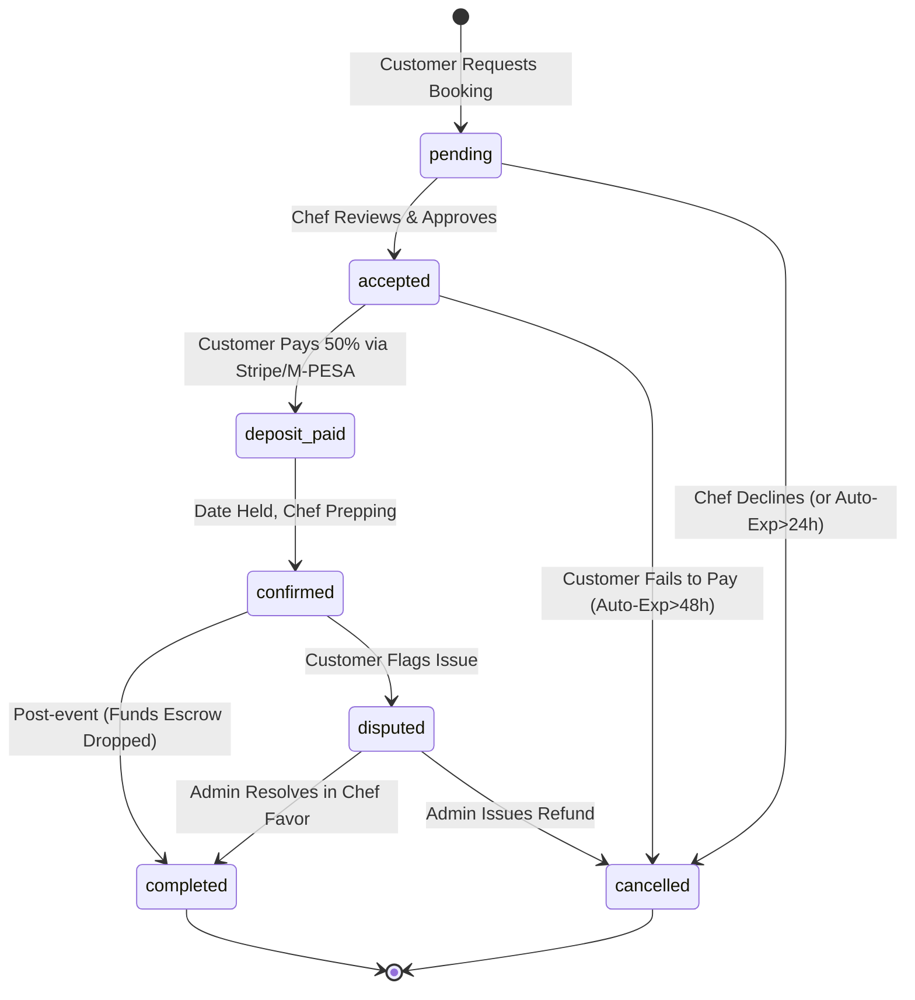

# Booking Lifecycle State Machine: ChefNyumbani

This outlines the linear progression of a booking, the required DB mutations, permissions, and notification triggers.

## 1. State Machine Definitions

## 2. Transition Rules Matrix

| Event Trigger | Valid From | To State | Triggered By | DB Action | Notification Sent |
| :--- | :--- | :--- | :--- | :--- | :--- |
| **Request booking** | `undefined` | `pending` | Customer | `INSERT INTO bookings` | **SMS/Email:** New request to Chef |
| **Accept request** | `pending` | `accepted` | Chef | `UPDATE bookings.status` | **SMS/Email:** Accept + Pay Link to Cust |
| **Decline request** | `pending` | `cancelled` | Chef | `UPDATE bookings.status` | **Email:** Declined notice to Cust |
| **Deposit received** | `accepted` | `deposit_paid` | System (Webhook) | `INSERT INTO payments`, `UPDATE bookings.status` | **Email:** Receipt to Cust, Prep notice Chef |
| **Admin confirms** | `deposit_paid` | `confirmed` | System/Admin | `UPDATE bookings.status`, Slot `is_booked = true` | None |
| **Event passes** | `confirmed` | `completed` | System (Cron) | `UPDATE bookings.status` | **Email:** Rate/Review request to Cust |
| **Report issue** | `confirmed` | `disputed` | Customer | `UPDATE bookings.status` | **Email:** Admin Alert |

## 3. Webhooks & Backend Considerations

**Stripe/M-PESA Webhooks (`deposit_paid` transition):**
Next.js API route `/api/webhooks/payment` receives external payload. 
- Verifies Signature.
- Finds `payment.provider_reference`. (e.g., Stripe Checkout Session ID).
- Updates `payment.status = 'paid'`.
- Finds associated `booking_id` and fires `UPDATE bookings SET status = 'deposit_paid'`.

**Escrow Payout (`completed` transition):**
- Can be automated via Supabase Postgres `pg_cron` jobs.
- `SELECT id FROM bookings WHERE status = 'confirmed' AND event_time < NOW() - INTERVAL '24 hours'`.
- This triggers payouts, releasing funds to the Chef.
